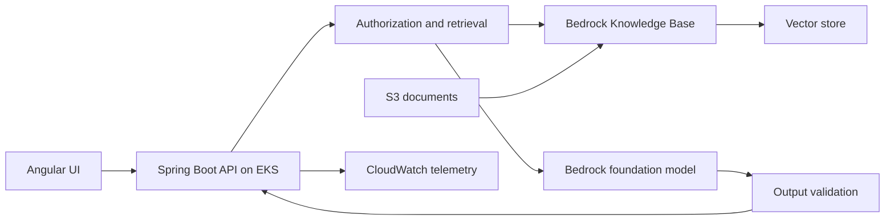

# Practical Implementation — Enterprise Document Assistant
> [!note] Supplementary example, not an official AWS lab
Use an Angular UI and Spring Boot API to answer questions about internal engineering documentation.

## Build sequence
- [ ] Define supported questions and evaluation dataset.
- [ ] Upload synthetic documents to S3 and configure retrieval.
- [ ] Invoke a compatible model using the AWS SDK for Java and an EKS workload identity.
- [ ] Return validated answers with source references; abstain when evidence is insufficient.
- [ ] Test tenant isolation, prompt injection, latency and cost.
- [ ] Add CI/CD evaluation gates and operational alarms.
- [ ] Delete unused resources after testing to avoid ongoing charges.

Do not use employer documents without permission. Choose a vector store, model and deployment Region after checking pricing and availability.

Related: [[03 - Amazon Bedrock Integration]] · [[04 - Proof of Concept]]
